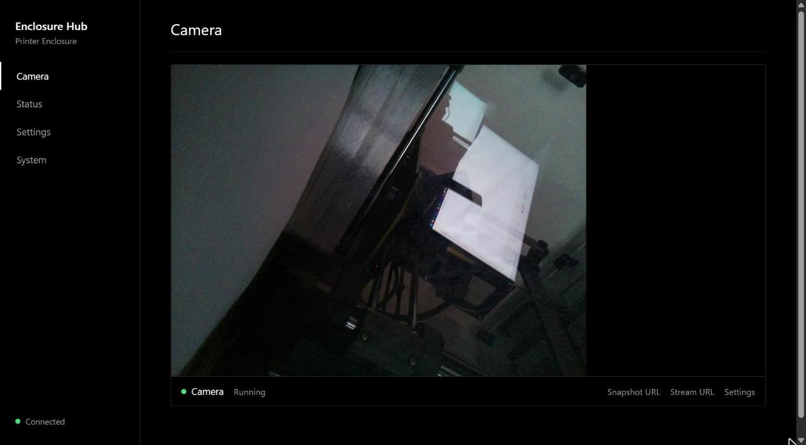
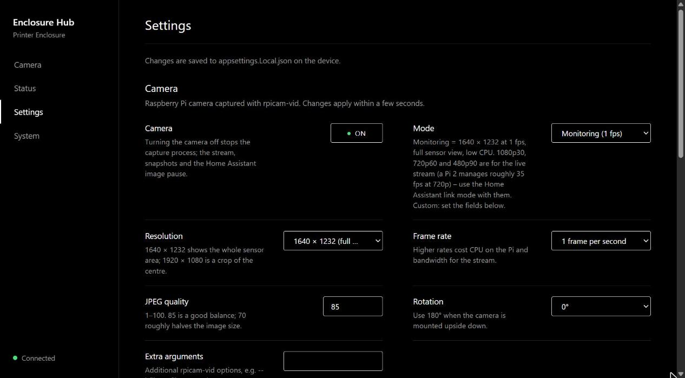

# Enclosure Hub

A small, modular controller for 3D printer enclosure accessories, running on a Raspberry Pi and
integrating with [Home Assistant](https://www.home-assistant.io/) – **fully local, no cloud, no Python**.

Built for a Prusa MK4S in an enclosure, but nothing in it is printer-specific. One self-contained .NET
binary on the Pi gives you a camera, a web dashboard, a local HTTP API and Home Assistant entities that
appear automatically via MQTT discovery. Lights, fans and a touch display are the next modules.

<p align="center">
  
  
</p>
<p align="center">
  
  
</p>

## What works today

- **Camera** – Raspberry Pi Camera Module via `rpicam-vid`: one long-lived process, latest JPEG kept in
  memory, MJPEG stream and snapshot over HTTP. Presets *Monitoring* (1640 × 1232 @ 1 fps), *1080p30*,
  *720p60*, *480p90* or a custom resolution / frame rate / quality / rotation. Can be turned off and on at runtime.
- **Home Assistant** – MQTT discovery; the device *Printer Enclosure* with Camera, *Camera running* and
  *CPU temperature* shows up without any YAML. Availability (last will), retained states, discovery
  republished when HA restarts. Camera either as an MQTT camera (JPEG pushed every few seconds) or in
  *link* mode (HA fetches snapshots itself; stream URL as an attribute) for fast camera modes.
- **Web dashboard** – black-and-white single-page UI served by the hub: live camera, entity status via
  Server-Sent Events, settings (applied live and saved on the device), system info and restart.
  Switchable off, optional HTTP Basic authentication.
- **Local HTTP API + SSE** – the contract for displays and other clients; the dashboard is its reference client.
- **Controller health** – CPU temperature and camera-running sensors.
- **Installation** – `deploy` script from your PC, then `sudo enclosurehub --install` creates and starts the systemd service.

## Not done yet

See [docs/ROADMAP.md](docs/ROADMAP.md) for details and the intended hardware.

- **Lighting** (M2) – LED strip with RGB + tunable white over PWM (Pi hardware PWM or PCA9685), exposed as a
  Home Assistant light. The `LightEntity` model and the HTTP command endpoint exist; no hardware module and no
  MQTT command handling yet.
- **Fans and climate** (M3) – PWM fans with optional tachometer, BME280/SHT31 temperature and humidity.
  `FanEntity` exists, hardware module does not.
- **Touch display** (M4) – a dedicated display client (web kiosk, Avalonia or ESP32) using the same API.
- **Printer awareness** (M5) – read PrusaLink locally and expose job progress.
- Smaller gaps: MQTT command topics (`{base}/{entity}/set`) are reserved but not consumed; secrets
  (MQTT, auth) can only be edited in the config file, not in the dashboard; HTTPS is not provided (LAN only).

The project is a personal build tested on exactly one setup (see Hardware). Expect rough edges.

## How it works

```
             ┌──────────── Enclosure Hub (Raspberry Pi) ────────────┐
 Hardware    │  Modules              Entities           Adapters    │   Clients
             │                                                      │
 Camera  ───►│  Camera (rpicam) ──► camera             ┌► MQTT ─────┼─► Home Assistant
             │                      camera_running ────┤             │
 /sys    ───►│  System sensors ──► cpu_temperature ────┤             │
             │                                         ├► HTTP API ──┼─► Touch display,
 PWM/I²C ───►│  Lights, fans (planned) ► light, fan     │  (REST+SSE) │   browser, scripts
             │                                         └► Dashboard ─┼─► Your browser
             └──────────────────────────────────────────────────────┘
```

- **Modules** talk to hardware and own **entities** (camera, sensor, binary sensor, light, fan).
- **Adapters** expose all entities to the outside world without knowing about hardware.
  Adding a fan module automatically makes the fan available in Home Assistant *and* on any display.
- Modules can also expose **settings sections**; the dashboard renders them generically.

Details: [docs/ARCHITECTURE.md](docs/ARCHITECTURE.md).

## Built on

| | |
|---|---|
| Runtime | [.NET 10](https://dotnet.microsoft.com/), published self-contained for `linux-arm` with ReadyToRun – nothing to install on the Pi |
| Web | ASP.NET Core minimal APIs, Kestrel, Server-Sent Events, static files; dashboard is plain HTML/CSS/JS (no framework, no build step) |
| MQTT | [MQTTnet 4.x](https://github.com/dotnet/MQTTnet) with Home Assistant MQTT discovery (`camera`, `image`, `sensor`, `binary_sensor`) |
| Camera | [`rpicam-apps`](https://www.raspberrypi.com/documentation/computers/camera_software.html) (`rpicam-vid --codec mjpeg`) and a small MJPEG frame splitter |
| Service | systemd (`Type=notify`), unit generated by `enclosurehub --install` |
| Tests | xUnit |

## Hardware

Developed and tested on:

- Raspberry Pi 2 Model B v1.1 (1 GB RAM, 32-bit ARMv7) – anything newer works too (use `-Runtime linux-arm64` on a 64-bit OS)
- Raspberry Pi Camera Module 2 (IMX219)
- Raspberry Pi OS Lite 13 (Trixie), 32-bit

Footprint on the Pi 2 in the monitoring preset: about 90 MB RSS for the hub, 15 % of one core for the camera.
The fast presets are limited by the software JPEG encoder (roughly 35 fps at 720p, using most of the CPU).

## Quick start

1. Prepare the Pi and Home Assistant: [docs/SETUP.md](docs/SETUP.md)
2. Build and deploy from your PC (requires the [.NET 10 SDK](https://dotnet.microsoft.com/download);
   nothing needs to be installed on the Pi except `rpicam-apps-lite`):

   ```bash
   ./deploy/deploy.sh pi@192.168.1.50           # Linux/macOS
   ./deploy/deploy.ps1 -Target pi@192.168.1.50  # Windows
   ```

3. On the Pi, install the systemd service (once):

   ```bash
   sudo /opt/enclosurehub/enclosurehub --install
   ```

4. On the Pi, create `/opt/enclosurehub/appsettings.Local.json` with your MQTT broker
   (see `src/EnclosureHub.App/appsettings.Local.example.json`) and restart:
   `sudo systemctl restart enclosurehub`
5. Open `http://<pi-address>:8080` – the web dashboard shows the camera.
   In Home Assistant the device **Printer Enclosure** appears under *Settings → Devices → MQTT*.

## Web dashboard

- **Camera** – live MJPEG view, running indicator, snapshot and stream links.
- **Status** – all entities with live values.
- **Settings** – camera on/off, mode presets, resolution, frame rate, JPEG quality, rotation, extra rpicam
  arguments; Home Assistant camera mode, image interval and hub address; dashboard on/off. Changes are
  written to `appsettings.Local.json` and applied live (the camera process restarts within a few seconds).
- **System** – version, host, uptime, memory and a *Restart service* button.

`Web:Dashboard:Enabled` turns the UI off (the API keeps working; re-enable it in the config file).
`Web:Auth:Username` / `Web:Auth:Password` protect **everything** the server serves (dashboard, API, camera
endpoints; only `/health` stays open) with HTTP Basic authentication. It is plain HTTP on your LAN, so treat
it as a lock against accidental changes rather than strong security.

## Configuration

`appsettings.json` holds defaults; put device-specific values and secrets in
`appsettings.Local.json` next to the executable (not deployed, not committed).

| Section | Purpose |
|---|---|
| `Device` | Id, name, manufacturer, model shown in Home Assistant |
| `Web` | `Dashboard:Enabled`; `Auth:Username`/`Auth:Password` (Basic auth for all endpoints except `/health`) |
| `Modules:Camera` | `Enabled`, `Width`/`Height`, `Framerate`, `Quality`, `Rotation` (0/180), `ExtraArgs` (e.g. `--hflip --vflip`) |
| `Modules:SystemSensors` | `Enabled`, polling interval |
| `Mqtt` | `Enabled`, broker `Host`/`Port`/`Username`/`Password`; `CameraMode` (`Image`/`Link`), `CameraImageIntervalSeconds`, `PublicUrl` |

Any value can also be set via environment variables, e.g. `Mqtt__Password=...`. The dashboard edits the
camera, Home Assistant camera-mode and dashboard values; everything else (broker, passwords) is file-only.

### Camera modes and Home Assistant

Fast camera modes are for the live MJPEG stream (dashboard, browser, Home Assistant's *MJPEG IP Camera*
integration). Pushing every frame through MQTT at those rates makes no sense, so `Mqtt:CameraMode` chooses
how Home Assistant sees the camera:

| `CameraMode` | Home Assistant entity | What is published |
|---|---|---|
| `Image` (default) | MQTT **camera** | JPEG bytes on `…/camera/image` every `CameraImageIntervalSeconds` (new frames only) |
| `Link` | MQTT **image** | A snapshot URL on `…/camera/url` (HA downloads the picture itself); nothing heavy goes through the broker |

In both modes the entity carries the attributes `stream_url`, `snapshot_url` and `dashboard_url`, built from
`Mqtt:PublicUrl` (auto-detected LAN address + port when empty). For live video in Home Assistant add the
**MJPEG IP Camera** integration with `stream_url`.

## HTTP API

| Endpoint | Description |
|---|---|
| `GET /` | Web dashboard (static files; 404 when `Web:Dashboard:Enabled` is false) |
| `GET /health` | Liveness check (never requires authentication) |
| `GET /api/entities` | All entities with current state |
| `GET /api/entities/{id}` | One entity |
| `POST /api/entities/{id}/command` | Control a light or fan, e.g. `{"on":true,"brightness":200}` |
| `GET /api/events` | Server-Sent Events – `state` event per entity on connect and on every change |
| `GET /api/cameras/{id}/snapshot.jpg` | Latest camera frame |
| `GET /api/cameras/{id}/stream.mjpeg` | MJPEG stream |
| `GET /api/settings` | Settings sections (fields + current values) exposed by the modules |
| `PUT /api/settings/{section}` | Apply settings, e.g. `{"enabled":false}` or `{"preset":"720p60"}` |
| `GET /api/system` | Version, host, uptime, memory |
| `POST /api/system/restart` | Graceful shutdown; systemd restarts the service |

## MQTT topics

With the default `Device:Id` = `enclosurehub`:

| Topic | Content |
|---|---|
| `enclosurehub/status` | `online` / `offline` (retained, last will) |
| `enclosurehub/{entity}/state` | Entity state (retained) |
| `enclosurehub/{entity}/image` | Camera JPEG (every `CameraImageIntervalSeconds`, new frames only; `CameraMode: Image`) |
| `enclosurehub/{entity}/url` | Snapshot URL for Home Assistant to fetch (retained; `CameraMode: Link`) |
| `enclosurehub/{entity}/attributes` | Camera attributes: `stream_url`, `snapshot_url`, `dashboard_url` (retained) |
| `homeassistant/{component}/enclosurehub/{entity}/config` | Home Assistant discovery (retained); camera uses component `camera` or `image` |

## Development

```bash
dotnet build
dotnet test
dotnet run --project src/EnclosureHub.App   # runs on Windows/Linux too; camera just keeps retrying
```

Repository layout: `src/EnclosureHub.Core` (entity + settings model), `src/EnclosureHub.Camera`,
`src/EnclosureHub.Mqtt`, `src/EnclosureHub.App` (host, API, dashboard, installer), `tests/`, `deploy/`, `docs/`.
Large parts of this project were written together with Claude Code.

## License

[MIT](LICENSE) © Tomáš Zenkner
