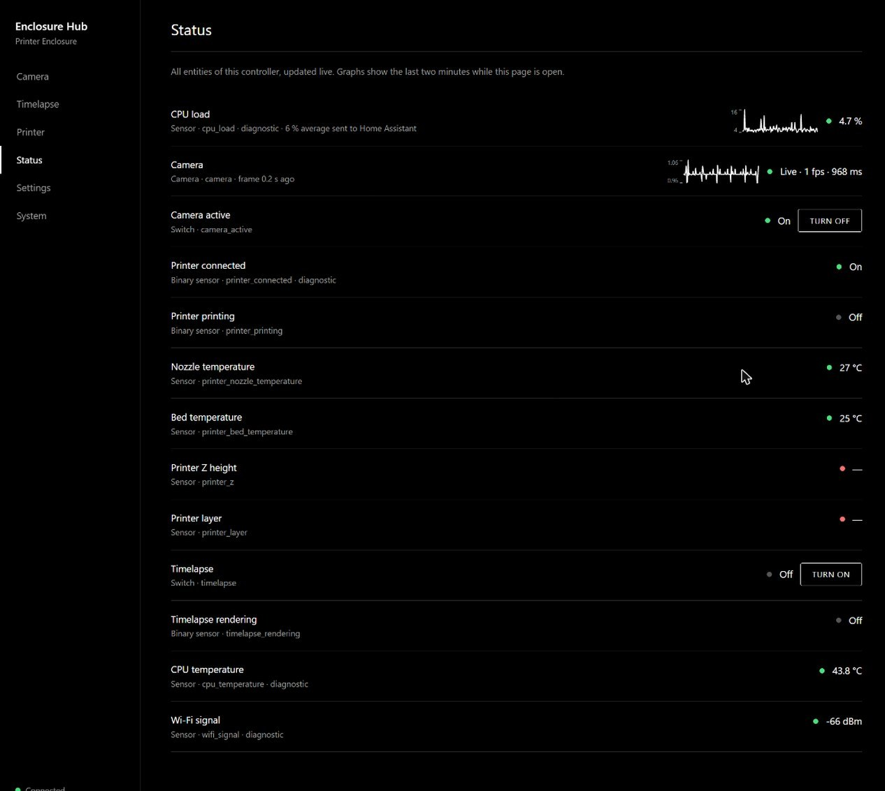
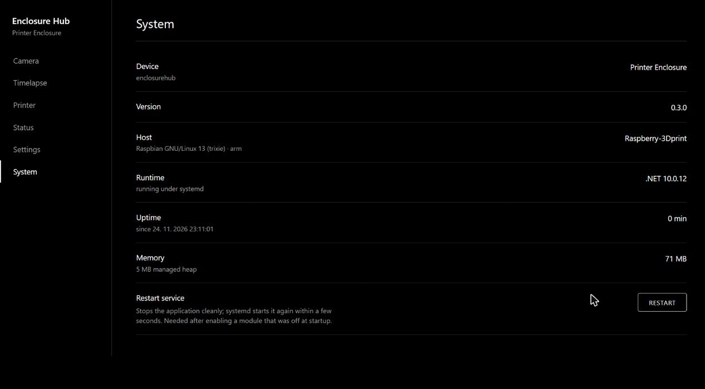

# Enclosure Hub

A small, modular controller for 3D printer enclosure accessories, running on a Raspberry Pi and
integrating with [Home Assistant](https://www.home-assistant.io/) – **fully local, no cloud, no Python**.

Built for a Prusa MK4S in an enclosure, but nothing in it is printer-specific. One self-contained .NET
binary on the Pi gives you a camera, a web dashboard, a local HTTP API and Home Assistant entities that
appear automatically via MQTT discovery. Lights, fans and a touch display are the next modules.

<p align="center">
  
  
</p>
<p align="center">
  
  
</p>

## What works today

- **Camera** – Raspberry Pi Camera Module via `rpicam-vid`: one long-lived process, latest JPEG kept in
  memory, MJPEG stream and snapshot over HTTP. Presets *Monitoring* (1640 × 1232 @ 1 fps), *1080p30*,
  *720p60*, *480p90* or a custom resolution / frame rate / quality / rotation. Can be turned off and on at runtime.
- **Timelapse** – while recording, the camera's latest frame is saved every N seconds (default 30 s); stopping
  renders the frames into an MP4 with ffmpeg in the background. Start/stop from the dashboard, Home Assistant
  (the **Timelapse** switch, e.g. driven by the printer state) or the API; videos can be played, downloaded and
  deleted on the dashboard's *Timelapse* page. Survives restarts, stops itself after a maximum duration (default
  48 h) or when the disk gets full. With a linked printer: a frame **per layer** instead of per N seconds and,
  optionally, recording that starts and stops with the print.
- **Printer connection** – Original Prusa with Buddy firmware (tested: MK4S) over its **USB-C port**: the hub
  knows when a print starts and ends (also when cancelled), every layer change, temperatures and Z height –
  without PrusaLink, API keys or changes in the slicer. Linked once from the dashboard, then it reconnects by
  itself whenever the printer is switched on. *Printer* page with live status and the communication log;
  optional entities for Home Assistant (a base for light and fan automations).
- **Home Assistant** – MQTT discovery; the device *Printer Enclosure* with Camera, a **Camera active**
  switch, a **Timelapse** switch with a *Timelapse rendering* sensor, *CPU temperature* and *Wi-Fi signal*
  shows up without any YAML. The switch turns the camera on
  and off from HA (e.g. only while the printer prints) and its state tells whether frames are really
  flowing – ON again while it is on but stuck restarts the capture. While the camera is off, HA shows the
  camera entity as unavailable and a "CAMERA OFF" picture instead of the last frame. Availability (last will), retained states, discovery
  republished when HA restarts. Camera either as an MQTT camera (JPEG pushed every few seconds) or in
  *link* mode (HA fetches snapshots itself; stream URL as an attribute) for fast camera modes.
- **Web dashboard** – black-and-white single-page UI served by the hub: live camera, entity status via
  Server-Sent Events, settings (applied live and saved on the device), system info and restart.
  Switchable off, optional HTTP Basic authentication.
- **Local HTTP API + SSE** – the contract for displays and other clients; the dashboard is its reference client.
- **Controller health** – CPU temperature and Wi-Fi signal strength (dBm, 0 when there is no Wi-Fi link).
- **Installation** – `deploy` script from your PC, then `sudo enclosurehub --install` creates and starts the systemd service.

## Not done yet

See [docs/ROADMAP.md](docs/ROADMAP.md) for details and the intended hardware.

- **Lighting** (M2) – LED strip with RGB + tunable white over PWM (Pi hardware PWM or PCA9685), exposed as a
  Home Assistant light. The `LightEntity` model and the HTTP command endpoint exist; no hardware module and no
  MQTT command handling yet.
- **Fans and climate** (M3) – PWM fans with optional tachometer, BME280/SHT31 temperature and humidity.
  `FanEntity` exists, hardware module does not.
- **Touch display** (M4) – a dedicated display client (web kiosk, Avalonia or ESP32) using the same API.
- **Printer-driven automations** – lights, fans and venting that follow the print (the printer connection
  already provides the events and entities).
- Smaller gaps: MQTT command topics (`{base}/{entity}/set`) are consumed for switches only (lights and fans
  will use JSON payloads); secrets (MQTT, auth) can only be edited in the config file, not in the dashboard;
  HTTPS is not provided (LAN only).

The project is a personal build tested on exactly one setup (see Hardware). Expect rough edges.

## How it works

```
             ┌──────────── Enclosure Hub (Raspberry Pi) ────────────┐
 Hardware    │  Modules              Entities           Adapters    │   Clients
             │                                                      │
 Camera  ───►│  Camera (rpicam) ──► camera             ┌► MQTT ◄────┼─► Home Assistant
             │                      camera_active ◄────┤             │
             │  Timelapse ────────► timelapse ◄───────┤             │
 USB-C   ───►│  Printer (Prusa) ──► printer_* ─────────┤             │
 /sys    ───►│  System sensors ──► cpu_temperature ────┤             │
 /proc   ───►│                     wifi_signal ────────┤             │
             │                                         ├► HTTP API ──┼─► Touch display,
 PWM/I²C ───►│  Lights, fans (planned) ► light, fan     │  (REST+SSE) │   browser, scripts
             │                                         └► Dashboard ─┼─► Your browser
             └──────────────────────────────────────────────────────┘
```

- **Modules** talk to hardware and own **entities** (camera, sensor, binary sensor, light, fan).
- **Adapters** expose all entities to the outside world without knowing about hardware.
  Adding a fan module automatically makes the fan available in Home Assistant *and* on any display.
- Modules can also expose **settings sections**; the dashboard renders them generically.

Details: [docs/ARCHITECTURE.md](docs/ARCHITECTURE.md).

## Built on

| | |
|---|---|
| Runtime | [.NET 10](https://dotnet.microsoft.com/), published self-contained for `linux-arm` with ReadyToRun – nothing to install on the Pi |
| Web | ASP.NET Core minimal APIs, Kestrel, Server-Sent Events, static files; dashboard is plain HTML/CSS/JS (no framework, no build step) |
| MQTT | [MQTTnet 4.x](https://github.com/dotnet/MQTTnet) with Home Assistant MQTT discovery (`camera`, `image`, `sensor`, `binary_sensor`) |
| Camera | [`rpicam-apps`](https://www.raspberrypi.com/documentation/computers/camera_software.html) (`rpicam-vid --codec mjpeg`) and a small MJPEG frame splitter |
| Timelapse | [ffmpeg](https://ffmpeg.org/) (the Pi's `h264_v4l2m2m` hardware encoder, `libx264` as fallback), run at idle priority |
| Printer | USB CDC serial (`System.IO.Ports`) to the Prusa Buddy firmware; Marlin-style reports and read-only queries (`M115`, `M27`, `M155`) |
| Service | systemd (`Type=notify`), unit generated by `enclosurehub --install` |
| Tests | xUnit |

## Hardware

Developed and tested on:

- Raspberry Pi 2 Model B v1.1 (1 GB RAM, 32-bit ARMv7) – anything newer works too (use `-Runtime linux-arm64` on a 64-bit OS)
- Raspberry Pi Camera Module 2 (IMX219)
- Original Prusa MK4S (firmware 6.5.7 and 8.0.2) on the USB-C printer connection
- Raspberry Pi OS Lite 13 (Trixie), 32-bit

Footprint on the Pi 2 in the monitoring preset: about 90 MB RSS for the hub, 15 % of one core for the camera.
The fast presets are limited by the software JPEG encoder (roughly 35 fps at 720p, using most of the CPU).

## Quick start

1. Prepare the Pi and Home Assistant: [docs/SETUP.md](docs/SETUP.md)
2. Build and deploy from your PC (requires the [.NET 10 SDK](https://dotnet.microsoft.com/download);
   nothing needs to be installed on the Pi except `rpicam-apps-lite` and, for timelapse videos, `ffmpeg` –
   the dashboard can install the latter for you):

   ```bash
   ./deploy/deploy.sh pi@192.168.1.50           # Linux/macOS
   ./deploy/deploy.ps1 -Target pi@192.168.1.50  # Windows
   ```

3. On the Pi, install the systemd service (once):

   ```bash
   sudo /opt/enclosurehub/enclosurehub --install
   ```

4. On the Pi, create `/opt/enclosurehub/appsettings.Local.json` with your MQTT broker
   (see `src/EnclosureHub.App/appsettings.Local.example.json`) and restart:
   `sudo systemctl restart enclosurehub`
5. Open `http://<pi-address>:8080` – the web dashboard shows the camera.
   In Home Assistant the device **Printer Enclosure** appears under *Settings → Devices → MQTT*.

## Web dashboard

- **Camera** – live MJPEG view, on/off switch, running indicator, snapshot and stream links.
- **Timelapse** – recording on/off with elapsed time, frame count and size, free disk space, render progress;
  list of finished videos with thumbnail, length and size – play, download, delete (failed renders can be
  retried or discarded).
- **Printer** (shown while the printer is linked) – connection, printer model and firmware, print state with
  file, progress, layer and Z, temperatures; the live communication log (sent / received lines, temperature
  reports hidden on request) and a *Read* button that asks an idle printer who it is (`M115`).
- **Status** – all entities with live values.
- **Settings** – in tabs: *Devices* (camera on/off, mode presets, resolution, frame rate, JPEG quality,
  rotation, extra rpicam arguments), *Printer* (link the printer, layer detection, queries, printer entities,
  and an overview of everything the link enables with its state), *Timelapse* (snapshot interval and maximum
  duration with a live estimate of frames, disk space and video length next to the current free disk space;
  video frame rate and encoder; ffmpeg status with a one-click *Install*) and *Integrations* (Home Assistant
  camera mode, image interval and hub address; dashboard on/off). Options that need the printer appear under a
  *Printer connection* heading on the Devices and Timelapse tabs once it is linked.
  Changes are written to `appsettings.Local.json` and applied live (the camera process restarts within a few seconds).
- **System** – version, host, uptime, memory and a *Restart service* button.

`Web:Dashboard:Enabled` turns the UI off (the API keeps working; re-enable it in the config file).
`Web:Auth:Username` / `Web:Auth:Password` protect **everything** the server serves (dashboard, API, camera
endpoints; only `/health` stays open) with HTTP Basic authentication. It is plain HTTP on your LAN, so treat
it as a lock against accidental changes rather than strong security.

## Configuration

`appsettings.json` holds defaults; put device-specific values and secrets in
`appsettings.Local.json` next to the executable (not deployed, not committed).

| Section | Purpose |
|---|---|
| `Device` | Id, name, manufacturer, model shown in Home Assistant |
| `Web` | `Dashboard:Enabled`; `Auth:Username`/`Auth:Password` (Basic auth for all endpoints except `/health`) |
| `Modules:Camera` | `Enabled` (module present), `Active` (camera on/off – the switch), `Width`/`Height`, `Framerate`, `Quality`, `Rotation` (0/180), `ExtraArgs` (e.g. `--hflip --vflip`), `CaptureOnLayerChange` (fresh frame per layer, off), `OnDemandFramerate` (1) |
| `Modules:Printer` | `Enabled`, `Linked` (set from the dashboard after the printer answered), `Port` (empty = auto-detect `/dev/serial/by-id/*Prusa*`), `Query` (M27/M155, on), `StatusIntervalSeconds` (10), `TemperatureIntervalSeconds` (5), `LayerDetection` (`ZChange`), `Entities` (on; read at startup), stored `MachineType`/`Firmware`/`Uuid` |
| `Modules:Timelapse` | `Enabled`, `IntervalSeconds` (30), `MaxDurationHours` (48), `VideoFps` (30), `Encoder` (`h264_v4l2m2m` hardware, default / `libx264`), `Crf`, `TurnCameraOn`, `Directory` (`timelapse` next to the executable), `MinFreeMegabytes` (stop when the disk gets this full), `CameraId`; with a printer: `LayerFrames` (on), `TimerFramesBetweenLayers` (off), `LayerMinInterval` (on), `FollowPrinter` (off) |
| `Modules:SystemSensors` | `Enabled`, polling interval |
| `Mqtt` | `Enabled`, broker `Host`/`Port`/`Username`/`Password`; `CameraMode` (`Image`/`Link`), `CameraImageIntervalSeconds`, `PublicUrl` |

Any value can also be set via environment variables, e.g. `Mqtt__Password=...`. The dashboard edits the
camera, printer, timelapse, Home Assistant camera-mode and dashboard values; everything else (broker, passwords) is file-only.

### Printer connection (Prusa over USB)

Connect the printer's **USB-C port** (back of the electronics box, above the LAN port) to a USB port of the Pi
with a USB-C ↔ USB-A cable. The printer appears as a serial device (`/dev/serial/by-id/usb-Prusa_Research…`);
Wi-Fi/LAN and PrusaLink keep working alongside. Then *Settings → Printer → Printer connection* **On**: the hub
asks the printer who it is (`M115`) and links it only if it answers; the model and firmware are stored, so the
hub keeps all printer settings and simply reconnects whenever the printer is switched on again.

What the hub learns from the printer (observed on an MK4S, checked against the Buddy firmware sources):

| Printer sends | Meaning for the hub |
|---|---|
| `File opened: /usb/NAME~1.BGC Size:…` | Print started (any source: USB drive, PrusaLink, Prusa Connect) |
| `X:… Y:… Z:0.40 …` once per layer | New layer (Z increase up to 1.5 mm; bigger jumps are travel/parking) |
| `Done printing file` | Print ended – finished **or cancelled** (not on pause) |
| `T:…/… B:…/…` | Temperatures (every 5 s with queries on, otherwise only while heating) |
| `SD printing byte A/B` | Answer to `M27`: progress, or a print running when the hub connects mid-print |

With *Query the printer* on (default) the hub sends `M155 S5` once and `M27` every 10 s – read-only commands
like OctoPrint uses. Off = listen only (start, layers and end still work). While the printer runs a blocking
command (heating, homing, mesh probing) it does not read the USB input and reports `echo:busy: processing` every
2 s; the hub then holds its queries back (and only sends the next one after the previous was answered), so they
never pile up. `M27` answers *Not SD printing* while paused, so it never ends a print by itself. A lost connection
does not end a print either: only a printer that stays away for more than 60 s (switched off), or answers *Not
SD printing* right after coming back, does. The Printer page hides temperature and busy lines unless you ask for them.

What uses the link (all only while the printer is linked; the values are kept when it is not):

- **Timelapse** – *Frame on every new layer* (on): while the printer is connected and printing, frames follow
  the layers instead of the snapshot interval; otherwise the interval applies, so nothing has to be switched
  back when the printer is off. *At least the interval between frames* (on): a layer change only saves a frame
  once the interval has passed since the previous one (thin layers do not make the video longer); off = every
  layer. *Also by the interval between layers* (off): long layers get timer frames too. *Start and stop with
  the print* (off – so it does not fight an existing Home Assistant automation).
- **Camera** – *New frame on every layer change* (off): the first frame after a layer change becomes the layer
  frame, and the timelapse waits for exactly that picture instead of taking the one in memory. At 1 fps and
  faster that is simply the next frame (≤ 1 s). Below 1 fps the camera captures at 1 fps (CPU like the
  Monitoring preset) and keeps only the regular frames plus one per layer. (rpicam-vid's own pause/resume was
  tried first: it keeps encoding while paused, 70 % CPU at 5 fps on a Pi 2.)
- **Entities** (*Printer entities*, on; after a restart): *Printer connected*, *Printer printing*, *Nozzle
  temperature*, *Bed temperature* (whole degrees), *Printer Z height*, *Printer layer* – for Home Assistant and
  displays, and later for light/fan rules. Turn them off if Home Assistant already gets the printer via PrusaLink.

The *Printer* page shows the live communication. Layer detection is a choice with one option for now
(*Z height change*); a custom G-code marker from the slicer can be added later. Tested with firmware 6.5.7 and
8.0.2 on an MK4S printing from the USB drive; other Buddy printers (MK4, MK3.9/3.5, MINI, XL, CORE One) speak
the same protocol but are untested.

### Timelapse

The timelapse never opens the camera itself – it takes the latest frame the camera module already holds in
memory, so the camera keeps running in its normal mode (e.g. *Monitoring*, 1 fps) and the timelapse simply
writes every 30th of those frames to disk (with the default 30 s interval). Only new frames are saved: while
the camera is off or stuck, nothing is written.

```
timelapse/sessions/<name>/000001.jpg …   frames of a recording (deleted after a successful render)
timelapse/videos/<name>.mp4              the video, plus <name>.jpg (thumbnail = last frame) and <name>.json
```

When a recording stops (switch off, maximum duration, disk nearly full) it is queued and rendered by ffmpeg at
idle priority – one video at a time, the camera and web server are not slowed down. If rendering fails (e.g.
ffmpeg is missing), the frames are kept and the dashboard offers *Retry* and *Discard*; after installing ffmpeg
from the dashboard, failed recordings are rendered automatically. A restart of the service resumes the current
recording and re-renders interrupted ones. Rough sizes with the Monitoring preset: ~300 kB per frame, i.e.
~35 MB of frames per hour at 30 s. While a recording is rendered, its frames and the new video are on disk
together, so the peak is frames + video; afterwards only the video stays. The Settings page computes this live
from the real frame size and the size of your previous videos, and a recording stops early when the remaining
space would not be enough to render it.

Without the printer connection, a Home Assistant automation can switch the timelapse – record while the printer prints:

```yaml
alias: Timelapse follows the printer
trigger:
  - platform: state
    entity_id: sensor.prusa_mk4s_printer_state
action:
  - service: >
      switch.turn_{{ 'on' if trigger.to_state.state == 'printing' else 'off' }}
    target:
      entity_id: switch.printer_enclosure_timelapse
mode: queued
```

(Pausing the print stops the recording and renders it; adjust the condition if you prefer to keep recording
through pauses, e.g. `in ['printing', 'paused']`.)

### Camera modes and Home Assistant

Fast camera modes are for the live MJPEG stream (dashboard, browser, Home Assistant's *MJPEG IP Camera*
integration). Pushing every frame through MQTT at those rates makes no sense, so `Mqtt:CameraMode` chooses
how Home Assistant sees the camera:

| `CameraMode` | Home Assistant entity | What is published |
|---|---|---|
| `Image` (default) | MQTT **camera** | JPEG bytes on `…/camera/image` every `CameraImageIntervalSeconds` (new frames only) |
| `Link` | MQTT **image** | A snapshot URL on `…/camera/url` (HA downloads the picture itself); nothing heavy goes through the broker |

In both modes the entity carries the attributes `stream_url`, `snapshot_url` and `dashboard_url`, built from
`Mqtt:PublicUrl` (auto-detected LAN address + port when empty). For live video in Home Assistant add the
**MJPEG IP Camera** integration with `stream_url`.

## HTTP API

| Endpoint | Description |
|---|---|
| `GET /` | Web dashboard (static files; 404 when `Web:Dashboard:Enabled` is false) |
| `GET /health` | Liveness check (never requires authentication) |
| `GET /api/entities` | All entities with current state |
| `GET /api/entities/{id}` | One entity |
| `POST /api/entities/{id}/command` | Control a switch, light or fan, e.g. `{"on":true}` or `{"on":true,"brightness":200}` |
| `GET /api/events` | Server-Sent Events – `state` event per entity on connect and on every change |
| `GET /api/cameras/{id}/snapshot.jpg` | Latest camera frame; a "CAMERA OFF" picture while the camera is switched off |
| `GET /api/cameras/{id}/stream.mjpeg` | MJPEG stream |
| `GET /api/timelapse` | Timelapse state: recording, frames, render queue, free space, ffmpeg (start/stop via `POST /api/entities/timelapse/command`) |
| `GET /api/timelapse/videos` | Finished videos, newest first |
| `GET /api/timelapse/videos/{name}.mp4` | The video (seekable; `?download=true` as an attachment); `{name}.jpg` is its thumbnail |
| `DELETE /api/timelapse/videos/{name}` | Delete a video |
| `POST /api/timelapse/recordings/{name}/render` / `DELETE …/recordings/{name}` | Retry or discard a recording whose render failed |
| `POST /api/timelapse/ffmpeg/install` | Install ffmpeg with `apt-get` in the background (needs passwordless sudo for the service user) |
| `GET /api/printer` | Printer link and connection, print state (file, progress, layer, Z), temperatures, stored model/firmware |
| `GET /api/printer/log?after={seq}` | Communication log entries newer than `seq` (last 500 kept: `in`, `out`, `info`) |
| `POST /api/printer/info` | Ask the printer who it is now (`M115`); 503 when it does not answer |
| `GET /api/settings` | Settings sections (fields + current values) exposed by the modules |
| `PUT /api/settings/{section}` | Apply settings, e.g. `{"enabled":false}` or `{"preset":"720p60"}` |
| `GET /api/system` | Version, host, uptime, memory |
| `POST /api/system/restart` | Graceful shutdown; systemd restarts the service |

## MQTT topics

With the default `Device:Id` = `enclosurehub`:

| Topic | Content |
|---|---|
| `enclosurehub/status` | `online` / `offline` (retained, last will) |
| `enclosurehub/{entity}/state` | Entity state (retained) |
| `enclosurehub/{entity}/available` | Per-entity availability; the camera is `offline` while switched off, so HA shows *unavailable* instead of the last frame (retained) |
| `enclosurehub/{entity}/set` | Commands from Home Assistant; switches accept `ON` / `OFF` (e.g. `enclosurehub/camera_active/set`, `enclosurehub/timelapse/set` – OFF stops the recording and renders the video) |
| `enclosurehub/{entity}/image` | Camera JPEG (every `CameraImageIntervalSeconds`, new frames only; `CameraMode: Image`) |
| `enclosurehub/{entity}/url` | Snapshot URL for Home Assistant to fetch (retained; `CameraMode: Link`) |
| `enclosurehub/{entity}/attributes` | Camera attributes: `stream_url`, `snapshot_url`, `dashboard_url` (retained) |
| `homeassistant/{component}/enclosurehub/{entity}/config` | Home Assistant discovery (retained); camera uses component `camera` or `image` |

## Development

```bash
dotnet build
dotnet test
dotnet run --project src/EnclosureHub.App   # runs on Windows/Linux too; camera just keeps retrying
```

Repository layout: `src/EnclosureHub.Core` (entity + settings model), `src/EnclosureHub.Camera`,
`src/EnclosureHub.Timelapse`, `src/EnclosureHub.Mqtt`, `src/EnclosureHub.App` (host, API, dashboard, installer), `tests/`, `deploy/`, `docs/`.
Large parts of this project were written together with Claude Code.

## License

[MIT](LICENSE) © Tomáš Zenkner
